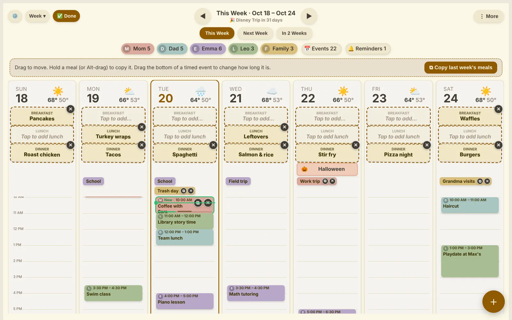
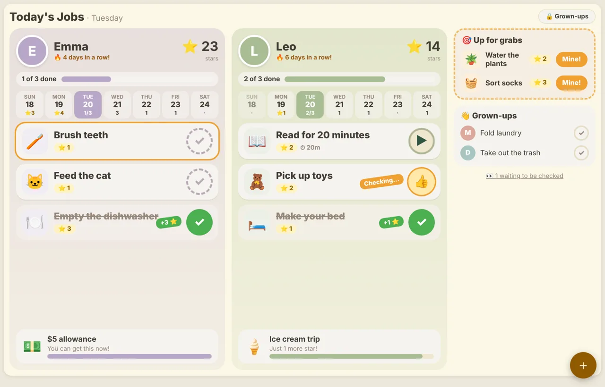
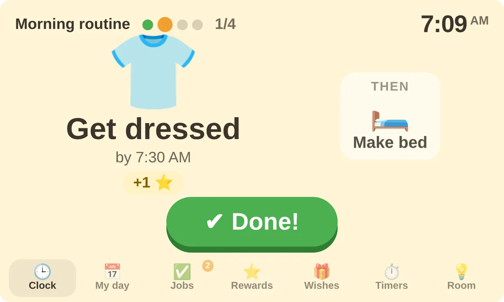
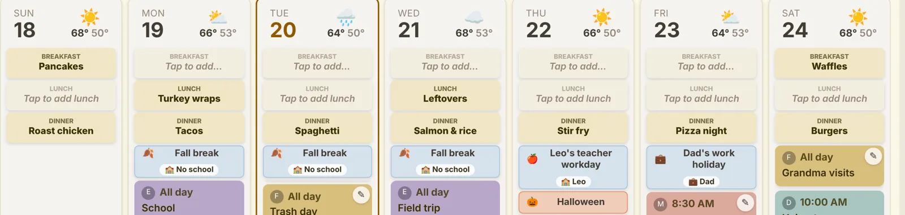

<h1 align="center">Family Hub</h1>

  A whole family-tablet dashboard for Home Assistant: calendar, meal planning, 
  chores, rewards, timers and more, in one install. 
  Runs entirely on your own Home Assistant, no cloud or subscription.

  <a href="#installation">Installation</a> · <a href="#a-look-around">Screenshots</a> · <a href="#features">Features</a> · <a href="#themes">Themes</a> · <a href="https://jvarhol.github.io/HA-Family-Hub/">Website &amp; docs</a> · <a href="https://jvarhol.github.io/HA-Family-Hub/docs/changelog">Changelog</a>

  

## A look around

### The family calendar

A week of everyone's calendars side by side, with breakfast, lunch and dinner planned at the top of each day. Switch between Week, Month, Planner and Agenda layouts, and tap any event to see details, edit it, duplicate it or turn it into a countdown.

<table>
  <tr>
    <td width="50%"> <b>Month</b> (HA Light theme)</td>
    <td width="50%"> <b>Planner</b>: one row per day, one column per person</td>
  </tr>
  <tr>
    <td width="50%"> <b>Agenda</b>: a simple list, great for a narrow screen (Liquid Glass Dark)</td>
    <td width="50%"> <b>Event details</b>: reminders, checklists, edit and duplicate (Midnight)</td>
  </tr>
</table>

   
  <b>Edit mode</b>: drag things to another day or time, duplicate, delete, and copy last week's meals

### Right Now, at a glance

Who's home, what everyone is doing right now and what's next, either as its own card or built into the top of the calendar.

  

   
  <b>Right Now card</b>: presence, battery and any other sensor per person (Liquid Glass Dark)

### Chores, rewards and lists

<table>
  <tr>
    <td width="50%"> <b>Chores</b>: a column per person, stars for every job, "Mark in progress"</td>
    <td width="50%"> <b>Rewards</b>: spend stars on rewards you set up (Blossom theme)</td>
  </tr>
  <tr>
    <td width="50%"> <b>To-Do lists</b>: any Home Assistant to-do list, side by side (Slate)</td>
    <td width="50%"> <b>Your own buttons</b>: e.g. a Guest Wi-Fi QR code, babysitter info or emergency contacts</td>
  </tr>
</table>

### For the kids

Kid-friendly views of the Chores, Rewards and To-Do cards, with big pictures and big buttons, and **Companion**: a card for the screen by a child's bed, with an ok-to-wake clock, their routine one step at a time, their day, jobs, rewards, wish list, timers and room buttons.

<table>
  <tr>
    <td width="52%"> <b>Kid-friendly Chores</b>: picture tiles, stars, streaks, goals and what they're saving for</td>
    <td width="48%"> <b>Companion</b>: the morning routine, one step at a time</td>
  </tr>
</table>

### Holidays, breaks and birthdays

Mark a calendar as Holidays, Birthdays or Special days and its days become banners, with ages and years. Add your own spring break, work holidays and vacations, and say who's off school or work.

  

### Today card and phones

<table>
  <tr>
    <td width="40%"> <b>Today card</b>: today's events, meals and reminders, for any dashboard (HA Light)</td>
    <td width="60%"> <b>On a phone</b>: the calendar stacks into one day at a time (Liquid Glass and HA Dark)</td>
  </tr>
</table>

## Themes

Ten built-in themes, plus every theme you have installed in Home Assistant. Each screen can use its own theme, and the Theme Builder lets you make your own (colours, fonts, glass transparency and blur, background image).

  

## Features

**Calendar**
- Week, Month, Planner and Agenda layouts, with a choice of how many days and rows to show.
- Any number of Home Assistant calendars. Each person gets a colour, a main calendar, and as many extra calendars as you like merged into their column.
- Add, edit, duplicate and delete events, including repeating events, on calendars that support it.
- Event reminders, checklists, countdowns, multi-person events, weather on each day, and an option to grey out past events.
- Edit mode: drag events, reminders, chores and meals to another day, drag an event to a new time or length, duplicate and delete in place, and copy last week's meals. Move an event to another calendar.
- Holiday, Birthday and Special days calendars as banners (with ages and years), your own holidays, breaks and vacations, and No school / No work days for everyone or just some people.
- Holiday Backgrounds: your own photos (up to 5, a different one each day) and a theme for a holiday's day, week or whole month.
- Tap an event's location for directions in Apple Maps, Google Maps or Waze.

**Meals and recipes**
- One to three meal blocks a day, recurring meals, whole-week templates, and suggestions from dishes you've made before.
- Wish lists that pull in GoWish and Amazon lists, each folded into its own section, with claiming so gifts stay a surprise.
- A searchable Recipe Box with ratings, and optional [Grocy](https://grocy.info) integration: a recipe viewer with servings scaling, recipe import from a link or pasted text, shopping lists and pantry tracking.

**Chores, rewards, goals and routines**
- Assigned, rotating or first-come chores that earn stars, a rewards catalog to spend them on, goals, and morning/afternoon/night routines.
- Rewards that only some people can get, rewards saved for later, and kids asking for new rewards or for stars.
- Per-person permissions, Child and Kiosk accounts, people without a Home Assistant login (moved to one later with everything they have), and a "Just me" view for each person.
- Kid-friendly views of the Chores, Rewards and To-Do cards: big pictures and big buttons a child can use on their own.

**Companion: a child's own screen**
- One card for the screen by a child's bed: an ok-to-wake clock, routines one step at a time, their day, jobs, rewards, wish list, timers they can start, buttons for their room, messages from you and a comfort button. You choose which screens each child gets.
- Follows your Family Hub theme (or its own per screen), and works with E-ink screens and Accessibility settings.

**Right Now, Today and the More menu**
- Right Now shows each person's current and next event, Home/Away, and any sensors or switches you choose.
- Today shows today's events, meals and reminders in a small card.
- Add your own buttons to the More menu: pop-ups with text, photos, links and QR codes (Wi-Fi, contacts, links and more, including your UniFi network's own Wi-Fi QR code). A pop-up can be locked so only chosen people can open it.

**Timers and alarms**
- Timers and alarms that ring on screens, phones and speakers until someone stops them, a Timer log, and actions and events for your automations.

**For a wall tablet**
- Screen Saver with video, camera feed, photos, clock and weather.
- See-through cards, so an animated dashboard background (like lovelace-animated-background) shows behind them.
- E-ink screens and Accessibility (shapes and patterns for colour blindness, high contrast, text size, easy-to-read fonts, reduce motion, bigger buttons).
- Privacy Mode keeps events behind a PIN lock screen; Discreet Mode hides names and event text but keeps the colours and times.
- Kiosk PIN sign-in, so a shared tablet knows who is using it.

**Also**
- Notifications sent by Home Assistant itself, so they arrive whether or not a dashboard is open: event reminders, reminders, chore due dates and a Daily Digest.
- Settings backups every 12 hours, which you can download and restore.
- Entities for automations: who's home, no school / no work today and tomorrow, privacy mode, timers, and chores as to-do lists.
- Available in English, German, Spanish, French, Italian, Dutch, Polish and Portuguese (Brazil). Each person sees their own Home Assistant language and 12/24-hour clock.

## Installation

Requires a few Home Assistant `todo.*` entities (for the recipe box, meal plan and reminders) and at least one `calendar.*` entity. See [Requirements](https://jvarhol.github.io/HA-Family-Hub/docs/requirements) in the docs.

### Option A: HACS (recommended)

Family Hub isn't in the default HACS store yet, so add it as a custom repository:

1. In Home Assistant, go to HACS → the ⋮ menu (top right) → **Custom repositories**, and add this repository's URL with category **Integration**, or use this one-click link:
   
2. Find **Family Hub** in HACS and click **Download**.
3. Restart Home Assistant.
4. Settings → Devices & Services → **Add Integration** → search for **Family Hub**, or use this link:
   

### Option B: Manual copy

1. Copy the `custom_components/family_hub` folder into your own `/config/custom_components/` (overwrite an existing install to update it).
2. Restart Home Assistant.
3. Settings → Devices & Services → **Add Integration** → search for **Family Hub**.
4. Add the card(s) you want to a dashboard. Each card has its own page under [Cards](https://jvarhol.github.io/HA-Family-Hub/docs/card-configuration) in the docs, with example YAML.

## Documentation

Everything else is on the **[Family Hub website](https://jvarhol.github.io/HA-Family-Hub/)**: a [getting-started guide](https://jvarhol.github.io/HA-Family-Hub/docs/intro), [installation](https://jvarhol.github.io/HA-Family-Hub/docs/installation), [requirements](https://jvarhol.github.io/HA-Family-Hub/docs/requirements), every feature in detail (starting with [the calendar](https://jvarhol.github.io/HA-Family-Hub/docs/features/calendar-and-layout)), [a page for every card](https://jvarhol.github.io/HA-Family-Hub/docs/card-configuration), [every setting](https://jvarhol.github.io/HA-Family-Hub/docs/settings-modal), [automations and entities](https://jvarhol.github.io/HA-Family-Hub/docs/features/automations-and-entities), [known limitations](https://jvarhol.github.io/HA-Family-Hub/docs/notes) and the [changelog](https://jvarhol.github.io/HA-Family-Hub/docs/changelog). The site has a search box, too.

Questions, ideas or want to show off your setup? Join the **[Family Hub discussion on Discord](https://discord.com/channels/330944238910963714/1543630448800960653)**.

Built to compete with commercial family-hub tablets (Skylight, Dragon Touch and others) while running entirely on your own Home Assistant.

Screenshots show sample data.

## License

Copyright (C) 2026 Bordello Labs.

Licensed under the GNU General Public License v3.0 (GPL-3.0); see [LICENSE](LICENSE) for the full text. You're free to use, study, modify, and redistribute this software, provided that any distributed copies (including modified versions) remain under the same license and keep their source available.
